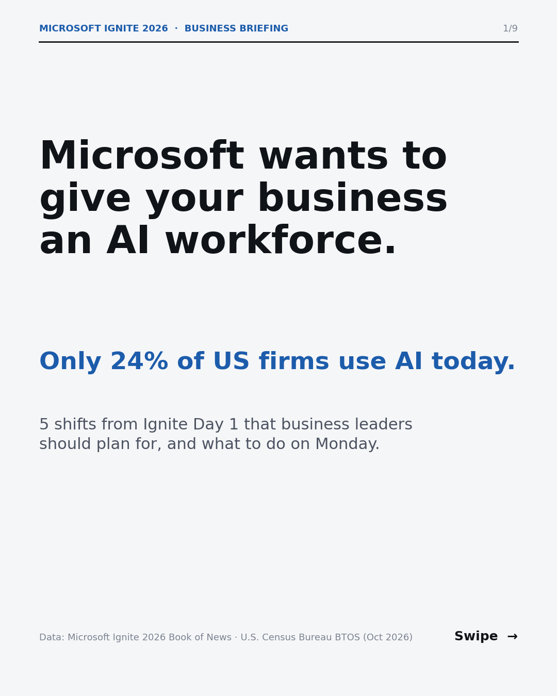
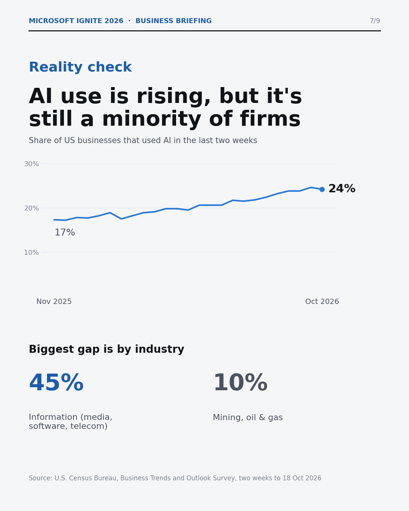
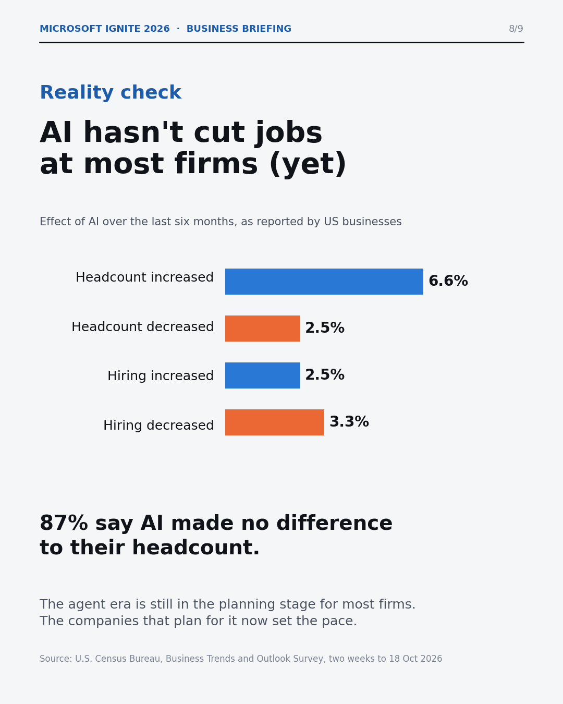

# Ignite 2026 business briefing

**Microsoft spent the Ignite 2026 keynote pitching an AI workforce. This project translates the Day 1 announcements into five shifts business leaders should plan for, and checks them against official US data on how many businesses actually use AI.**



## The five shifts

| # | Shift | Do on Monday |
|---|---|---|
| 1 | AI agents get a line manager (Agent 365 Cost Management, Business Analytics) | Name one owner for AI spend and agree on two success measures |
| 2 | Copilot becomes where the workday starts (Office in Copilot, Home, Today, Autopilot) | Pilot three routine workflows with one team |
| 3 | You'll pay for usage, not just seats (Copilot Credits, Agent 365 FinOps) | Budget for AI as a consumption cost with caps and alerts |
| 4 | Copilot works with tools beyond Microsoft (Salesforce in Copilot, Microsoft IQ's 350+ connectors) | Map your key data and existing connectors before buying more tools |
| 5 | Security teams govern agents as well as people (Entra Agent ID, Purview, Defender, Perception) | Inventory every agent: owner, access, actions |

## The reality check (U.S. Census Bureau, two weeks to 18 Oct 2026)

- **24.2%** of US employer businesses used AI in the last two weeks, up from **17.3%** in Nov 2025.
- AI use is **45%** in information firms and **10%** in mining, oil and gas.
- Over the last six months, **2.5%** of firms say AI reduced their headcount, **6.6%** say it increased it, and **87%** report no change.

| | |
|---|---|
|  |  |

## What's here

```
src/census.py         Census BTOS spreadsheets -> data/processed/*.csv
src/announcements.json  Curated Ignite Day 1 announcements, with availability labels from the Book of News
src/build_page.py     -> outputs/briefing.html (interactive briefing page)
src/carousel.py       -> outputs/linkedin_carousel.pdf + outputs/slides/*.png (1080x1350)
LINKEDIN_POST.md      Post copy
```

## Run it

```bash
python3 -m venv .venv && source .venv/bin/activate
pip install -r requirements.txt
cd src
python census.py --refresh   # downloads the latest Census survey wave
python build_page.py
python carousel.py
```

## Sources and notes

- **Announcements:** [Microsoft Ignite 2026 Book of News](https://news.microsoft.com/events/ignite/2026/book-of-news/) and the [live news page](https://news.microsoft.com/events/ignite/2026/live-news/), 17 Nov 2026. Availability labels (GA, Preview, Frontier) are Microsoft's. The McKinsey budget figures are as cited by Microsoft.
- **Business data:** [U.S. Census Bureau, Business Trends and Outlook Survey](https://www.census.gov/hfp/btos/data_downloads). In 2026 the questionnaire renamed AI "Super Intelligence (formerly AI)"; the question is otherwise the same.
- The "Do on Monday" actions are my own recommendations.

## License

Code: MIT. The Census data is public domain.
